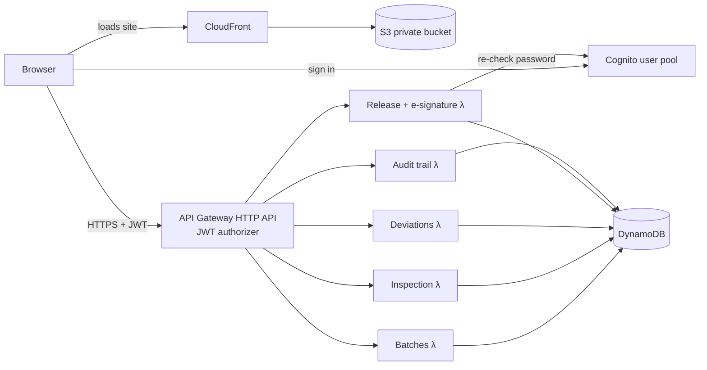

# QualityLink prototype

Cloud prototype of **QualityLink**, the inspection, deviation and batch release system designed for the fictional Meridian Medical Components and its client Halden Pharma.
CSC1057 IT Architecture, Group Nuvola, Project Part 3.

> All data is fictional sample data. Demo accounts only.

**Live prototype:** _add the CloudFront link after deploying_

## Demo accounts

All demo accounts use the password `Nuvola-Demo-2026`. The sign-in page also has one-click buttons for them.

| Username | Role | What they can do |
|---|---|---|
| `operator.kelly` | Line operator | Record inspection results on the line terminal |
| `engineer.murphy` | Quality engineer | Investigate deviations, clear or reject holds |
| `qa.walsh` | QA approver | Review release checks and release with an e-signature |
| `client.larsen` | Halden Pharma | See own batches, download certificates |

## Demo story (5 minutes)

1. **Operator** records a reading on B-24121. An out-of-spec value puts the batch **on hold** and opens a deviation automatically.
2. Click the green **Online** button to simulate an internet outage. Readings are kept on the "gateway" and **sync automatically** when you go back online.
3. **Quality engineer** opens DEV-0412 (B-24117), starts the investigation, records the root cause and closes it. Every edit needs a reason for change.
4. **QA approver** sees all release checks pass, re-enters their password (e-signature) and releases B-24117. A wrong password is refused and logged.
5. **Client** sees only Halden's batches and downloads the Certificate of Conformance.
6. The **audit trail** shows every step: who, what and when.

Reset the data before a demo with `bash scripts/reset-demo.sh`.

## Architecture



Everything runs in **eu-west-1 (Ireland)** and is defined in one CloudFormation/SAM template (`template.yaml`).

### Prototype vs the Part 2 design

| Part 2 component | In the prototype | Notes |
|---|---|---|
| CloudFront + S3 front end | **Built** | Private bucket, Origin Access Control, HTTPS only, security headers |
| Cognito sign-in, role-based access | **Built** | 4 groups; no self sign-up; staff SSO + MFA is future work |
| API Gateway | **Built** | JWT authorizer, CORS locked to our site, throttling |
| Lambda modules | **Built (5 of 7)** | Inspection (+ spec check, hold), Deviations, Batch Release + e-signature, Audit Trail, Batches/Client Portal. Not built: Integration (ERP) |
| Least-privilege IAM per module | **Built** | e.g. Audit Lambda can only read; no role can edit or delete audit entries |
| RDS PostgreSQL Multi-AZ + RDS Proxy | **Replaced by DynamoDB** | Free tier and serverless for the prototype; Part 2 keeps RDS for production |
| Greengrass edge gateway + IoT Core | **Simulated** | Browser caches specs and queues readings offline, then syncs (store-and-forward) |
| S3 Object Lock audit archive | Not built | Audit entries are append-only in DynamoDB instead |
| EventBridge, SNS alerts, SQS to ERP | Not built | The alert is shown as an audit entry |
| Frankfurt pilot-light DR, KMS CMKs, WAF, GuardDuty, VPC | Not built | Design only (Part 2) |
| CodePipeline + validation account | Not built | Deployed with one script from CloudShell |

### API

| Method + path | Lambda | Roles |
|---|---|---|
| `GET /batches` | batches | all (clients get only their own, limited fields) |
| `GET /batches/{id}` | batches | operator, engineer, qa |
| `GET /batches/{id}/certificate` | batches | client (own), qa, engineer |
| `POST /batches/{id}/readings` | inspection | operator |
| `GET /deviations` | deviations | engineer, qa |
| `PATCH /batches/{id}/deviations/{devId}` | deviations | engineer |
| `POST /batches/{id}/release` | release | qa |
| `GET /audit?batchId=` | audit_trail | engineer, qa |

### Data (DynamoDB)

| Table | Key | Holds |
|---|---|---|
| Batches | `batchId` | Part, PO, client, approved spec, status, release signature |
| Readings | `batchId` + `readingId` | Each inspection result, who, when, offline or live |
| Deviations | `batchId` + `deviationId` | Investigation, root cause, outcome |
| Audit | `pk` + `sk` (time) | Append-only log of every action |

## Deploy (AWS CloudShell)

1. Sign in to the AWS console, switch the Region to **Europe (Ireland) eu-west-1**, open **CloudShell** (bottom left).
2. Run:
   ```bash
   git clone https://github.com/EmirDemirkol/qualitylink-prototype.git
   cd qualitylink-prototype
   bash scripts/deploy.sh
   ```
3. The script prints the live URL at the end. The first deploy takes about 5 minutes.

To update after changing code: `git pull` then `bash scripts/deploy.sh` again.

## Run and test locally (no AWS account)

```bash
pip install boto3 "moto[dynamodb,cognitoidp]" pytest
python -m pytest tests -q          # backend tests: the whole release story
python tests/local_server.py       # then open http://localhost:8765
```

## Repository structure

```
template.yaml        All AWS infrastructure (CloudFormation + SAM)
backend/             One Python file per Lambda module, plus common.py
frontend/            Static website: index.html, css/, js/ (no framework)
scripts/             deploy.sh and reset-demo.sh
tests/               Backend tests (moto), local server, browser walkthrough
```

## Cost

Built for the AWS Free plan: Lambda, DynamoDB (20 of the always-free 25 read/write units), Cognito and CloudFront stay inside free limits at demo usage. A zero-spend budget alarm is set on the account.

## Known limitations

- Demo passwords are shared and public; production uses company SSO + MFA.
- DynamoDB scans are fine for sample data but would need indexes at production volume.
- The offline gateway is simulated in the browser, not real edge hardware.
- Certificates are rendered in the browser (print to PDF) rather than stored in S3.
